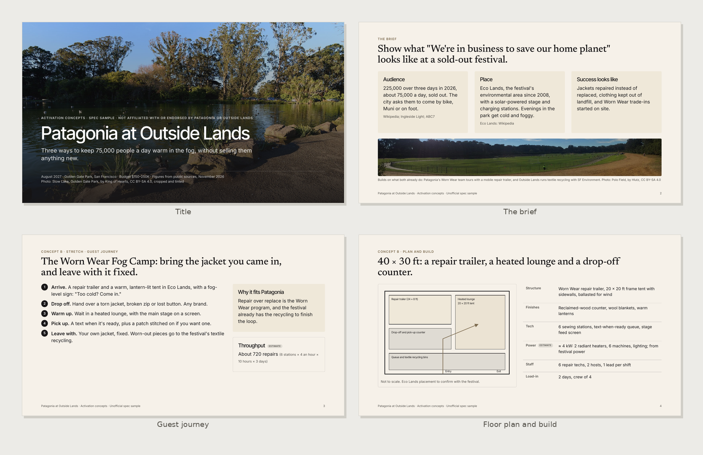
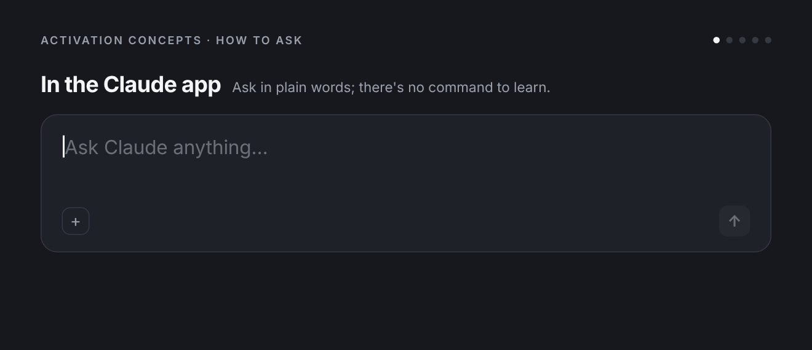

# Activation Concepts

Turn a brand, a place and a budget into three experiential concepts a client can choose from: one safe, one stretch, one bold. Each concept explains what guests do, what gets built, what it costs roughly, and what could go wrong, so the conversation can move straight to "which one?".

**What you get:** Develops three experiential activation concepts for a brand at a venue, event or public space and delivers them as a designed 16:9 concept deck PDF with presenter notes. Each concept gets the big idea, the guest journey step by step, a simple floor plan diagram, materials and fabrication notes, tech, staffing, timeline, a budget range, risks and permits, and how success is measured.



**See the full sample:** [Sample-Patagonia-at-Outside-Lands-Activation-Concepts.pdf](examples/Sample-Patagonia-at-Outside-Lands-Activation-Concepts.pdf) (an unofficial spec sample in Patagonia's colors, with sourced figures and credited, freely licensed photos; not affiliated with or endorsed by Patagonia or Outside Lands)

Made by Beautiful Engine · [beautifulengine.com](https://www.beautifulengine.com) · [Questions or ideas? Open an issue](https://github.com/BeautifulEngine/activation-concepts/issues/new)

## Install

### Claude app (web or desktop)

1. Download **[activation-concepts.zip](activation-concepts.zip)** from this repo (open the file, then use the download button). Don't unzip it.
2. Turn on **Settings > Capabilities > "Code execution and file creation"**.
3. Go to **Customize > Skills**, click **+**, then **+ Create skill > Upload a skill**, and upload the zip.
4. Start a new chat and ask in plain words. Claude picks the skill up on its own.

> GitHub's green "Code > Download ZIP" button won't work for this; it wraps everything in an extra folder. Use `activation-concepts.zip`.

### Claude Code

As part of the Beautiful Engine collection (you get updates and the other skills):

```bash
claude plugin marketplace add BeautifulEngine/skills
claude plugin install beautiful-engine@beautiful-engine
```

Then use `/beautiful-engine:activation-concepts`, or ask in plain words. Or install just this one:

```bash
git clone https://github.com/BeautifulEngine/activation-concepts.git
mkdir -p ~/.claude/skills && cp -r activation-concepts/activation-concepts ~/.claude/skills/
```

Then use `/activation-concepts`.

## Usage



```
/activation-concepts <brand> at <venue or event> [budget range] [audience] [goal]
```

Plain requests work too:

- "Three activation concepts for Patagonia at Outside Lands, budget $150–250K."
- "Pop-up ideas for a skincare launch in a 1,200 sq ft SoHo storefront, two weeks."
- "We have a 20×20 booth at CES for a robotics startup. Give me concepts."
- "Here's the client brief (attached). Turn it into three activation concepts."
- Add "one concept" for a single concept in depth, or "rough" for a quick 6-slide version.

If the person has a brief, follow it exactly and quote its objectives back on the second slide. If key facts are missing (budget, footprint, dates, audience), pick sensible defaults, list them on the brief slide as assumptions, and say so in the reply.

**Files.** `<skill-dir>` means this skill's folder, the one holding this SKILL.md. Templates are in `assets/`, scripts in `scripts/`, and the shared PDF steps (fonts, colors, render, check) are in `references/rendering.md`.

## When Claude uses it

Someone asks for activation ideas, experiential concepts, a pop-up, booth or installation concept, a brand experience for an event, or a creative response to an activation brief.

## How it works

```
activation-concepts/
├── SKILL.md
├── assets/  base.css, concepts-template.html, deck.css
├── scripts/  audit.js, contact_sheet.py, fonts.py, render.cjs, render.py, tokens.py
├── references/  brand-extraction.md, rendering.md
```

PDFs are built from HTML templates, colored and typeset with the right brand, rendered by headless Chrome, then checked for fonts, text contrast and leftover blanks before delivery. Anything with numbers in it is calculated by a script, not estimated.

## Works well with

- [Sponsorship Pitch](https://github.com/BeautifulEngine/sponsorship-pitch)
- [Build Spec](https://github.com/BeautifulEngine/build-spec)
- [Project Quote](https://github.com/BeautifulEngine/project-quote)
- [All Beautiful Engine skills](https://github.com/BeautifulEngine/skills)

## Made by Beautiful Engine

Activation Concepts is made by [Beautiful Engine](https://www.beautifulengine.com), a creative studio in Los Angeles working across brand, experiential and interactive design.

- **Website:** [beautifulengine.com](https://www.beautifulengine.com)
- **Questions, ideas, or something broke?** [Open an issue](https://github.com/BeautifulEngine/activation-concepts/issues/new) and describe what you asked for and what happened.

This repo is published from [BeautifulEngine/skills](https://github.com/BeautifulEngine/skills); changes are made there and copied here.

## License

MIT. See [LICENSE](LICENSE).

